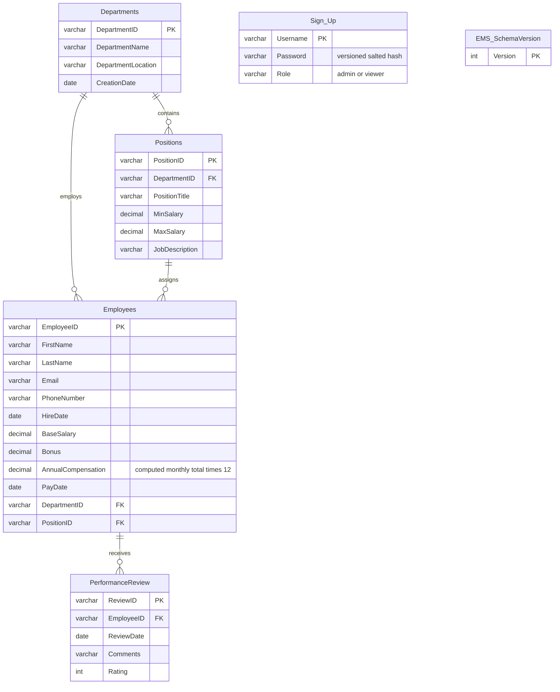

# Current design

Launch selection defaults to `.env.preview`; the positional `production` argument selects `.env.production`. `--env-file` selects an operator configuration instead. Configuration reads preserve exported process overrides without modifying process variables, preventing one file from contaminating later launches. Missing files fail closed. Initial read-only connection opening retries only Azure SQL resume error 40613, at most three times with increasing waits. No service write has an automatic retry.

The console calls `Service`, which validates inputs and checks account privileges before using SQLAlchemy mapped models inside `Database.session()`. Models live under `src/ems/models.py`; queries use mapped attributes and bound values, and inserts/updates/deletes are tracked by the ORM. Imports never connect to SQL Server or create tables. Each short session commits or rolls back and closes before returning to the menu. The engine uses `NullPool`, and pyodbc pooling is disabled before application connections are created, allowing Azure serverless to pause when no clients remain connected.

Schema changes and seed data remain fixed, versioned administrative SQL resources under `src/ems/sql`, executed only through the allowlisted `Database.script()` path. The ORM does not replace database constraints, account permissions, migration review or backups. Metadata-based table creation is used only in SQLite test fixtures; production initialization uses the reviewed SQL scripts.

`admin` can manage all application data and create accounts. `viewer` can read departments and position descriptions only. Authentication clears any previous session, verifies a versioned password hash, upgrades verified legacy hashes in the same transaction, and establishes the session only after commit. No account role is inferred from a username or an employee record.

A composite foreign key from `Employees(PositionID, DepartmentID)` references the unique pair on `Positions`, preventing inconsistent department assignments. Departments, positions, and review-to-employee relationships are mandatory. Account records are independent of employees.

The report ORM query joins the mapped employee, department, position and review tables and includes employees without reviews through a left join. It returns one row per review when there are multiple reviews. The SQL view remains available for external reporting. Deleting an employee deletes their reviews within the same session transaction; a failure rolls back both deletes. Records are ordered explicitly and display queries select named attributes, so migration can change physical column order safely. SQL Server update/range-lock hints serialize first-admin provisioning and competing employee edits.

The current schema and migration use version 1. New databases use `001_schema.sql`; original databases use `002_migrate_legacy.sql`. Both fail instead of silently accepting unsupported versions or changing business data. SQL scripts use `XACT_ABORT`, transactions, and `THROW`; sample inserts are separate and never overwrite existing records.

The optional `004_change_journal.sql` extension is installed in both configured Azure environments. Five DML triggers and a database DDL trigger append committed-change metadata to `EMS_ChangeJournal`; `EMS_SecurityFeatures` versions the extension independently of the version-1 application schema. Runtime access to both extension tables is explicitly denied. All five business/account mappings disable implicit RETURNING for SQL Server trigger compatibility. The journal omits sensitive field values and SQL text, rolls back with the originating transaction, and remains under database-owner control. On-demand review runs separately from the application. See [free-only hardening](FREE_SECURITY_HARDENING.md) for setup, monitoring signals and coverage limits.

The current console is intended for trusted local operators. It has no web/API surface, persistent session store, complete SQL access audit, payment engine, or independent protection against a user who already controls the database account. Backups and restore drills remain SQL Server operational responsibilities.
